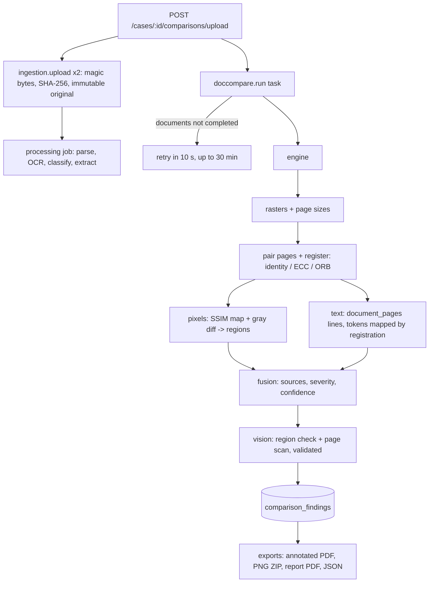

# Design: Document Comparison Lab

## Flow

## Modules (`backend/app/services/doccompare`)
| File | Role |
|---|---|
| `geometry.py` | Boxes, inward-rounded `clip`, `Frame` (page ⇄ raster ⇄ work px), `transform_box` |
| `registration.py` | 3x3 matrix `M` (test work px → original work px); best SSIM of identity, ECC, ORB |
| `pages.py` | Rasters, page sizes, `PagePair` with box mapping in both directions |
| `visual.py` | Changed-pixel mask and regions |
| `text.py` | Line comparison, word-level location, added and removed text |
| `fusion.py` | `Candidate`, evidence confidence and its basis, severity, explanation |
| `vision.py` | Qwen2.5-VL prompts, schema validation, box validation, pixel verification |
| `engine.py` | Orchestration without database access; CPU work in a thread |
| `annotate.py`, `report.py` | Annotated PDF and PNGs, report PDF, JSON |
| `service.py` | API side (create, upload, list, detail, retry, review, exports, links) |
| `run.py` | Worker side (wait, run, persist, generate exports) |

## Coordinates
Every stored box is `[x0, y0, x1, y1]`, top-left origin, in its own document's page units (PDF points, or pixels for image files), the same as extracted-field boxes. `PagePair.test_box_to_original` and `original_box_to_test` go through work px and `M`. `clip` rounds inward to 0.01 so a validated box never leaves its page.

## Evidence confidence
| Evidence | Base |
|---|---|
| text and pixels, text layer | 0.80 |
| text and pixels, OCR | 0.70 |
| text only, text layer | 0.60 |
| text only, OCR | 0.45 |
| pixels only | 0.40 |
| vision proposal confirmed by pixels | 0.45 |
| page count | 0.90 |

The OCR base is multiplied by the lowest OCR confidence (at least 0.5). The vision model adds or removes 0.10. A page SSIM below 0.5 removes 0.15. The result is clamped to [0.05, 0.95] and every step is stored as `metrics.confidence_basis`.

Severity is medium for page changes, digit changes or an overlap with an extracted amount, date, reference or quantity; low for other text; low or info for pixel-only regions (by size).

## Data
Migration `0008` creates `document_comparisons`, `comparison_findings`, `comparison_reviews` (append-only grant) and `comparison_exports`, all with `organization_id`, RLS and the tenant policy. Check constraints cap severity, bound confidence and require a file and hash on a completed export.

## Decisions
| Decision | Why | Rejected |
|---|---|---|
| Reuse ingestion and the pipeline for both files | One validation path; OCR lines and fields already exist | A separate lab upload store |
| The VLM never creates a finding on its own | Live `qwen2.5vl:7b` boxes were off by 30-40 px or outside the image | Trusting model boxes |
| Deterministic text and pixels first | Reproducible findings | LLM-first comparison |
| Exports from persisted rows | Every mark resolves to a stored finding | Rendering from engine memory |
