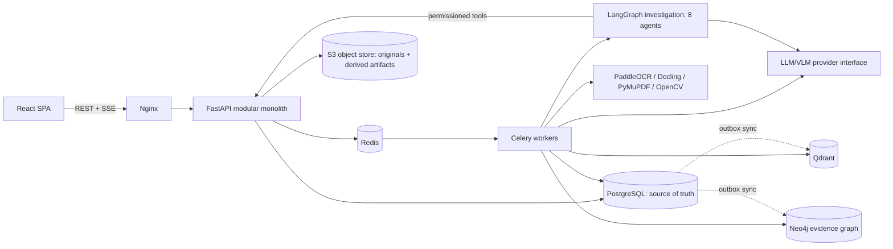
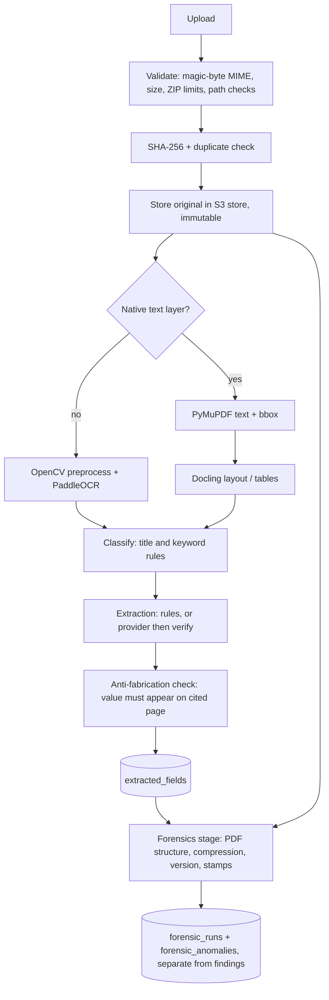
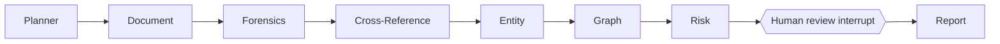
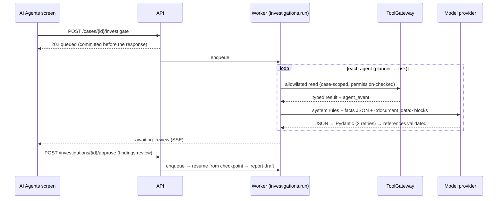
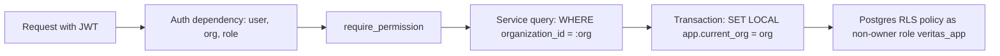

# VERITAS AI architecture

VERITAS AI is a **modular monolith**. One FastAPI application and one Celery worker codebase share a single Python package (`backend/app`). PostgreSQL is the only source of truth. Neo4j and Qdrant (later phases) are derived views fed by a transactional outbox, so they can be rebuilt at any time.

## System diagram

## Document pipeline (Phase 2)

## Investigation workflow (Phase 6)

Each agent has a tool allowlist and a Pydantic output model. The investigation shares one budget: iterations, tool calls, provider-reported tokens and wall-clock time. A reference validator removes any citation that doesn't resolve to a row of the same organization and case. Every step is persisted in `agent_runs` and `agent_events`, and the run pauses before the report until a reviewer approves it.

## Modules

| Module | Location | Responsibility and boundary |
|---|---|---|
| core | `app/core` | Config, security primitives, logging, errors, permission map. No business logic. |
| identity | `app/services/identity` | Users, organizations, memberships, roles, JWT and refresh tokens. Issues the `organization_id` every query filters on. |
| audit | `app/services/audit` | Append-only audit log. |
| jobs | `app/services/jobs`, `app/workers` | Persisted job state, Celery tasks, SSE event streams. |
| ingestion | `app/services/ingestion` | Upload, validation, hashing, duplicate detection, storage. Never modifies originals. |
| classification, ocr, parsing, extraction | `app/services/...` | Document type, text and layout, structured fields. Writes `document_pages` and `extracted_fields` only. |
| forensics (built) | `app/services/forensics`, `app/api/v1/forensics.py` | PDF structure and visual analysis: pure analyses (`pdf_structure`, `visual`, `versions`, `stamps`) orchestrated by `analyze.py`, and `runner.py` as the fifth pipeline stage, after `validate`. It reads the original bytes, the extracted field boxes (to relate regions to values) and the superseded version. Results are stored in `forensic_runs` and `forensic_anomalies`, separate from extraction and from findings. Severity is capped at medium, and every run states its limitations. Depends on core, identity and ingestion, as in the matrix. Reading `extracted_fields` and `documents` rows is the only coupling to extraction. |
| doccompare (built) | `app/services/doccompare`, `app/api/v1/doccompare.py`, `app/workers/doccompare_tasks.py` | The Document Comparison Lab: an original versus a test document. `pages`/`registration` rasterize and align each page pair (identity, ECC or ORB homography), `text` compares the stored text-layer or OCR lines, `visual` finds changed-pixel regions, `fusion` scores them, `vision` checks the strongest regions with Qwen2.5-VL through the provider interface (its boxes are validated and only pixel-confirmed proposals are kept), and `annotate`/`report` render annotated copies, a report and JSON from the persisted rows. Uses ingestion for both uploads, reads `document_pages` and `extracted_fields`, and reuses `forensics/imaging.py` for rasters and SSIM (see the matrix). |
| entity_resolution | `app/services/entity_resolution` | Entity normalization and matching. |
| comparison | `app/services/comparison` | Deterministic cross-document rules first, LLM interpretation last. Creates findings and evidence. Pure rules (`rules/*.py`) and engine, plus `persist.py` for the idempotent upsert. It runs at the end of every processing job and on demand (`cases.compare` task). |
| graph (built) | `app/services/graph`, `app/integrations/graph`, `app/workers/graph_tasks.py` | The pure projection (`projection.py`), the Postgres rebuild in the comparison's transaction with an outbox row (`service.py`), the outbox drain and reconciler (`sync.py`) on the worker's embedded beat, and Neo4j (`neo4j_store.py`, namespaced, parameterized Cypher). The API reads Neo4j and falls back to Postgres. Depends on comparison and entity_resolution, as in the matrix below. |
| findings | `app/services/findings` | Review of persisted findings: list, detail, status decisions (evidence rule, required notes), comments, assignment to a member, and document requests. Never creates findings. |
| graph | `app/services/graph` | Neo4j projection of entities and relationships through the outbox. Every edge carries an `evidence_id`. |
| investigation (built) | `app/agents`, `app/workflows/investigation_pipeline.py`, `app/workflows/checkpointer.py`, `app/services/investigations`, `app/workers/investigation_tasks.py` | Eight LangGraph agents (`AgentSpec` each) that reach the other modules only through `ToolGateway`. The gateway enforces read-only tools, per-agent allowlists, the starter's permissions and case scoping. The workflow also has a reference validator, a shared budget, the human-review interrupt before the report, and Postgres checkpoints under RLS. The API side is in `services/investigations/service.py`, and the worker side is `run.py`. |
| risk | `app/services/risk` | Anomaly score, evidence confidence and investigation priority, kept separate. |
| reporting (built) | `app/services/reporting`, `app/api/v1/reports.py`, `app/workers/report_tasks.py` | `builder.py` builds a `ReportModel` from persisted rows only. `verify.py` re-resolves every citation (with the same validator the agents use) and checks the summary. `render.py` renders PDF (PyMuPDF), DOCX, XLSX and JSON from one layout. `service.py` runs the job, stores the file once with its SHA-256, and serves signed, hash-checked downloads. |

## Dependency matrix

A row depends on the columns marked ●.

| Module | core | identity | ingest | extract | forensics | entity | compare | graph | invest | report |
|---|---|---|---|---|---|---|---|---|---|---|
| identity | ● | | | | | | | | | |
| ingestion | ● | ● | | | | | | | | |
| extraction | ● | ● | ● | | | | | | | |
| forensics | ● | ● | ● | | | | | | | |
| doccompare | ● | ● | ● | ● | ● | | | | | |
| entity | ● | ● | | ● | | | | | | |
| comparison | ● | ● | | ● | | ● | | | | |
| graph | ● | ● | | | | ● | ● | | | |
| investigation | ● | ● | | ● | ● | ● | ● | ● | | |
| reporting | ● | ● | | ● | ● | | ● | ● | ● | |
| frontend | | ● | ● | ● | ● | | ● | ● | ● | ● |

The doccompare row reads extraction's `document_pages` (the text to compare) and `extracted_fields` (to link a difference to the values it touches) without writing them, and reuses the raster and SSIM primitives of `forensics/imaging.py` so both labs measure similarity the same way.

Phase 7 added extraction and forensics to the reporting row. Both are read-only: the report has "extracted information" and "forensic observations" sections (reporting requirement 1.1), and a report must work without an investigation run. Reading them through the investigation agents would make every report depend on one. The `structure` steering was updated to match.

## Tenant isolation

The application connects to Postgres as `veritas_app`. That role doesn't own the tables and has no `BYPASSRLS`, so row-level security always applies. Migrations run as the owner role in a separate one-shot container.

## Evidence chain

original file (sha256) → `document_pages` → `extracted_fields` (page, bbox, method, model_version) → `evidence_items` → `findings` → report citation. Graph edges carry an `evidence_id`.

## Key decisions

| Decision | Reason | Alternative rejected |
|---|---|---|
| Modular monolith | One deployable fits the team size and deadline, with clear module boundaries | Microservices (operational cost with no benefit at this scale) |
| RLS plus explicit filters | A missed `WHERE` clause can't leak data | Application filters only |
| Opaque rotating refresh tokens | Can be revoked, and token theft is detected through reuse | Long-lived JWT refresh tokens |
| SSE for progress | One-way, survives proxies, resumes with `Last-Event-ID` | WebSockets (two-way isn't needed) |
| Deterministic comparison first | Reproducible findings. The LLM only interprets. | LLM-first comparison (not reproducible) |
| OpenAI-compatible provider | Covers hosted APIs and local Qwen servers with one interface | A vendor SDK per provider |
